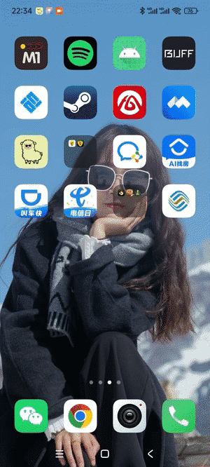

# LyricHud · Android

把**酷狗音乐正在播放的歌词**，实时推给树莓派上的小屏幕。

配套的树莓派端：[LyricsDisplay](https://github.com/1053278842/LyricsDisplay)



---

## 它做了什么

```
酷狗音乐 ──MediaSession──► 本 App ──请求歌词 API──► 整理成 JSON
                                  │
                            BLE 扫描：找树莓派广播的 IP
                                  │
                                  └──HTTP POST──► 树莓派 :5588/upload ──► 小屏
```

App 里用 **Chaquopy** 内嵌了 Python，歌词的抓取/格式化复用树莓派仓库里的同一套代码（`main.py` + `lyrics/`）。

---

## 下载安装

[](https://github.com/1053278842/lyrics_hud_android/releases/latest)

👉 **[下载最新 APK](https://github.com/1053278842/lyrics_hud_android/releases/latest)**（当前 `v1.0.0`，约 24 MB）

> ⚠️ 这是 **debug 签名**的个人自用包。如果手机上装过别人编译的版本，会提示签名冲突，**需要先卸载**。

安装后首次打开，会依次申请下面这些权限，**全部同意**：

| 权限 | 用途 | 不给会怎样 |
| --- | --- | --- |
| 通知使用权 | 通过 `MediaSessionManager` 拿到酷狗的播放状态 | 抓不到歌名/进度 |
| 定位（精确） | Android 8~11 扫 BLE 的硬性要求（Android 12+ 已改成"附近的设备"） | 扫不到树莓派 |
| 附近的设备（蓝牙扫描/广播/连接） | BLE 找树莓派、以及老方案的热点广播 | 外设链接永远红 |
| 后台运行 / 自启动 / 关闭电池优化 | 锁屏后继续推歌词（小米/华为需要手动开） | 息屏一会儿就断 |
| POST_NOTIFICATIONS | 前台服务常驻通知 | 服务可能被系统杀掉 |

---

## 用法

1. **手机和树莓派连同一个 Wi-Fi**（不需要手机开热点）
2. 打开 App → 点「运行」
3. 等「外设链接」变绿（树莓派通过 BLE 广播了它的 IP）
4. 打开酷狗，放一首有歌词的歌
5. 树莓派的小屏上就会出现歌词

---

## 五个状态灯是什么意思

| 状态 | 含义 | 必须绿吗 |
| --- | --- | --- |
| 通知监听 | 是否有通知使用权 | ✅ 必须 |
| 音乐状态 | 是否抓到了酷狗的 `MediaSession`（酷狗要正在运行） | ✅ 放歌时应该绿 |
| 热点状态 | App 能否创建 LocalOnlyHotspot | ❌ **不用管**，很多手机（尤其小米/HyperOS）会拒绝 |
| 蓝牙广播 | 手机是否在广播热点 SSID（老方案，让树莓派来连热点） | ❌ 不用管 |
| 外设链接 | **是否收到树莓派广播的 IP**（`company id 0x1234`） | ✅ 必须 |

> 只要「外设链接」绿了，就说明 App 知道该往哪个 IP 发数据了。热点那两个红灯完全不影响使用。

---

## 为什么不需要热点

App 会监听树莓派的 BLE 广播：树莓派每隔一段时间广播一次自己的 IP（4 字节 manufacturer data）。

手机收到就把 IP 存进 `MainActivity.raspberry_ip`，之后所有 HTTP 都发到 `http://<IP>:5588/upload`。

所以只要两端在同一个局域网，哪个 IP 都能自动发现。

---

## 自己构建

**环境**：JDK 17、Android SDK 34、Python 3.9~3.12

```bash
git clone https://github.com/1053278842/lyrics_hud_android.git
cd lyrics_hud_android

# 同步 Python 源码（从 LyricsDisplay 仓库）
bash scripts/sync_python.sh ../LyricsDisplay

# Windows
./gradlew assembleDebug -PbuildPython=C:/Python311/python.exe
# Linux / macOS
./gradlew assembleDebug -PbuildPython=$(command -v python3)
```

产物：`app/build/outputs/apk/debug/app-debug.apk`

也可以直接推一个 `v*` tag，GitHub Actions 会自动编译并挂到 Release（见 `.github/workflows/build-apk.yml`）。

### 目录说明

```
app/src/main/java/com/example/lyrichud/
├── MainActivity.java                 # 主界面 + 服务开关
├── PermissionHelper.java             # 一堆权限引导
├── ServiceManager.java               # 把热点/BLE/前台服务串起来
├── MyNotificationListenerService.java
├── model/StatusModel.java            # 5 个状态灯的唯一数据源
├── ui/StatusUpdater.java
├── python/PythonBridge.java          # Java ↔ Python 的桥
└── service/
    ├── LyricForegroundService.java   # 每秒读酷狗 MediaSession
    ├── BleScanner.java               # 收树莓派 IP
    ├── BleAdvertiser.java            # 广播热点 SSID（老方案）
    └── WifiHotspotManager.java       # LocalOnlyHotspot
app/src/main/python/                  # ★ 从 LyricsDisplay 同步来的 Python 代码
```

---

## 常见问题

| 现象 | 原因 / 处理 |
| --- | --- |
| 外设链接一直红 | 树莓派的 `lyrichud-ble.service` 没跑，或者手机定位服务/蓝牙权限没给 |
| 热点打不开 | 正常，不影响使用；只要同一个 Wi-Fi 就行 |
| 开了 Clash 就没歌词 | VPN 把 `192.168.x.x` 也送进隧道了，把局域网加到直连列表 |
| 锁屏后停了 | 关电池优化 + 允许自启动（小米还要开"后台弹出界面"） |
| 状态都绿但屏幕不显示 | 问题在树莓派那边，看 [LyricsDisplay 排查手册](https://github.com/1053278842/LyricsDisplay/blob/main/docs/TROUBLESHOOTING.md) |

---

## License

MIT